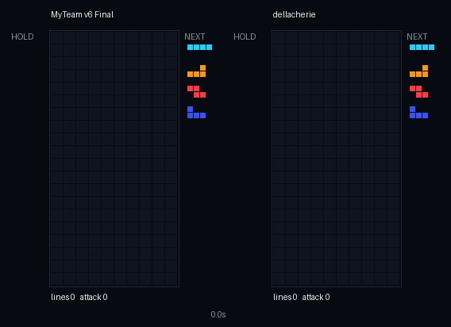
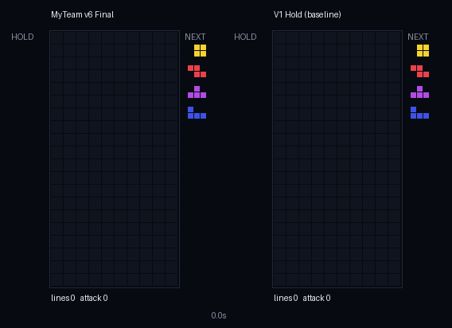

# Tetris 1v1 AI Agent

강화학습 세미나 테트리스 1:1 대전 대회 출전 Agent.
**배치 탐색 + 유전 알고리즘(GA) + 강화학습(RL) 보정 + 2수 앞보기 + 대전 특징**을 단계적으로 쌓아 만들었고, 정책 기반 RL(PPO)로 미세 조정한 버전과도 비교했다.



*왼쪽: 최종 Agent v6, 오른쪽: 룰베이스 dellacherie (2배속)*

## 결과 요약

최종 Agent **v6** (`agents/my_agent/`)의 성적이다. 공식 `evaluate.py`로 측정했고, 학습에 쓰지 않은 seed를 사용했다.

| 상대 | 결과 |
|---|---:|
| dellacherie (룰베이스) | **40전 40승** |
| codemyroad_genetic (룰베이스) | **40전 40승** |
| v1 (처음 버전: Dellacherie + hold) | **100전 71승** |
| v5 (직전 버전) | **200전 112승** |

`act()` 응답 시간은 약 9ms다(제한 50ms). 추론은 순수 Python만 사용한다.



*왼쪽: 최종 Agent v6, 오른쪽: 처음 버전 v1 (2배속)*

## 버전별 진화

| 버전 | 바꾼 것 | 이전 버전 대비 |
|---|---|---|
| v1 | Dellacherie 가중치로 배치 탐색 + **hold** 판단 추가 | dellacherie 상대 37/40 |
| v2 | **GA 1차**로 가중치 학습 | v1 상대 82/140 |
| v3 | **GA 2차** (v2에서 이어서) | v2 상대 61/100 |
| v4 | **RL 가치 보정** (GA 점수 + 50 × V) | v3 상대 131/240 (우위 작음) |
| v5 | **2수 앞보기** (빔 3) | v4 상대 54/100 |
| v6 | **대전 특징 5개** 추가 후 GA | v5 상대 112/200 |

v6 위에서 PPO 미세 조정도 시도했지만 v6 상대 57/120(47.5%)으로 넘지 못해 v6를 최종으로 정했다(아래 방법 6).

전체 수치와 seed 목록은 [`results/README.md`](results/README.md)에 있다.

## 방법

### 1. 배치 탐색

엔진은 매 tick 9개 버튼(이동, 회전, 드롭, hold) 중 하나를 고르게 한다. Agent는 버튼을 직접 학습하지 않는다. 대신 **"조각을 어느 회전·어느 x에 놓을지"**를 고르고, 그 결정을 버튼 순서로 바꿔 실행한다.

1. 현재 조각과 hold 조각으로 놓을 수 있는 모든 자리(약 68곳)를 시뮬레이션한다.
2. 놓은 뒤 보드(afterstate)에서 특징 16개를 계산하고 가중치를 곱해 점수를 매긴다.
3. 가장 높은 자리를 `[HOLD] + 회전 + 좌우 이동 + 하드드롭`으로 실행한다.

이렇게 하면 문제가 "한 경기에 수천 번 버튼 고르기"에서 **"조각마다 수십 개 후보 중 하나 고르기"**로 줄어든다.

### 2. 유전 알고리즘 (GA)

가중치 묶음 20\~24개를 대결시켜 승률(+ 공격량 차이)로 순위를 매긴다. 상위 4개를 남기고, 나머지는 교배와 변이로 새로 만든다. 출발점은 Dellacherie 가중치이고, 이후 GA는 직전 최고 버전에서 이어서 출발했다.

**상대 선택**이 중요했다. Agent가 룰베이스를 모두 이기게 된 뒤에는 룰베이스와의 경기에서 후보 간 차이가 나지 않았다. 그래서 직전 세대 1등(챔피언)과 보관해 둔 이전 버전(v3, v4)을 상대로 썼다(`--rivals`).

### 3. 강화학습 보정 (GA + RL)

GA 점수에 학습한 가치함수 V를 더한다: **점수 = GA 점수 + β × V(afterstate)**.

- 경험 수집: 현재 정책 + ε-greedy(5%)로 v3, v1, dellacherie와 대결
- 보상: 공격 1줄당 +0.05, 승리 +1 / 패배 −1, γ = 0.98
- 정책 평가: 특징 → 몬테카를로 리턴을 ridge 회귀로 맞춤
- 정책 개선: 새 V로 다시 행동, 5라운드 반복

테트리스의 배치는 결과가 정해져 있어서 V(놓은 뒤 보드)를 알면 Q(s, a)를 아는 것과 같다. 그래서 DQN과 같은 가치 기반 방법을 afterstate 형태로 적용했다.

### 4. 2수 앞보기

1수째 상위 3개 후보에 대해 다음 조각의 최고 배치까지 시뮬레이션하고, **1수째 점수 + 2수째 최고 점수**로 고른다. 다음 조각은 화면에 보이므로 예측이 아니라 확정된 정보다.

### 5. 대전 특징

보드 모양만 보던 11개 특징에 대전 상황을 보는 5개를 추가했다.

| 특징 | 의미 |
|---|---|
| `garbage_risk` | 줄을 못 지우면 이번에 올라올 수 있는 garbage 줄 수 |
| `danger` | garbage까지 올라왔을 때의 최고 높이 |
| `cancel` | 이번 공격으로 상쇄하는 garbage 줄 수 |
| `b2b_break` | B2B 중에 1\~3줄로 지워서 체인을 끊는지 |
| `attack` | 상쇄 후 상대에게 실제로 보내는 공격 (서든 데스 배율 반영) |

### 6. PPO (정책 기반 RL)

같은 점수 공식을 **확률적인 정책**으로 바꿔, 가중치를 PPO로 직접 고쳐 봤다.

- Actor: 후보 배치마다 logit = (가중치 · 특징) / T, softmax로 확률을 만들어 샘플링. 가중치는 v6에서 출발
- Critic: V(s) = c + u · (정책이 고를 배치들의 평균 특징)
- 학습: GAE(λ = 0.95), 클립 0.2, KL 상한 0.02, 반복당 80경기 × 30회. 상대는 v6, v1, dellacherie
- 온도 T = 0.3: T = 1에서는 탐험이 많아 학습 중 승률이 약 20%에 그쳤다. 0.3으로 낮추자 승률이 50% 안팎이 되어 이기는 경기와 지는 경기가 고르게 섞였다

학습은 안정적이었다(KL 약 0.001, 학습 중 승률 0.54 → 0.58). 가중치는 대부분 ±0.4 이내로 움직였고, **`attack`(상대에게 보내는 공격)만 2.35 → 4.68로 두 배**가 됐다. PPO가 "공격을 더 중시하라"는 일관된 신호를 찾은 것이다. 하지만 실전 방식(1등만 고르기 + 2수 앞보기)으로 v6와 붙이면 57/120(47.5%)으로 차이가 없었다.

## 강화학습 관점에서 본 구조

### 세미나 개념과의 대응

| 강화학습 개념 | 이 프로젝트에서 |
|---|---|
| 상태 (state) | 보드, 현재·hold·next 조각, 들어올 garbage, B2B, 서든 데스 단계 |
| 행동 (action) | 엔진은 9개 프레임 버튼. Agent는 그 위에서 **배치(회전, x, hold 여부)**를 고르고 버튼으로 풀어서 실행 |
| 보상 (reward) | RL 단계: 공격 1줄당 +0.05, 승리 +1 / 패배 −1 |
| 정책 π | 점수가 가장 높은 배치를 고르는 greedy 정책 (PPO에서는 점수 기반 softmax 확률 정책) |
| 가치 V(s) | 놓은 뒤 보드(afterstate)의 가치 = GA 점수 + β × 학습한 V |
| 정책 평가 → 개선 | RL 단계에서 "경험 수집 → V 학습 → V로 다시 행동"을 5라운드 반복 |
| 탐험 | RL 보정: ε-greedy 5%. PPO: softmax 샘플링 (온도 0.3) |
| 모델 기반 계획 | 엔진 규칙으로 배치 결과를 미리 시뮬레이션 (배치 탐색, 2수 앞보기) |

### DQN과의 관계

DQN은 그대로 쓰지 않았지만, RL 단계는 **DQN과 같은 가치 기반 방법**이다. 테트리스의 배치는 결과가 정해져 있어서, 놓은 뒤 보드의 가치 V(afterstate)를 알면 Q(s, a) = 보상 + V(놓은 뒤 보드)를 아는 것과 같다. 그래서 행동마다 Q를 따로 배우는 대신 afterstate 가치를 배웠다.

| | DQN | 이 프로젝트의 RL 단계 |
|---|---|---|
| 배우는 것 | Q(s, a) | V(afterstate) |
| 함수 | 신경망 | 특징 16개(V는 11개)의 선형 함수 |
| 학습 목표 | TD: r + γ · max Q(s′, a′) | 몬테카를로: 실제로 받은 리턴 G |
| 탐험 | ε-greedy | ε-greedy (5%) |
| replay buffer, target network | 사용 | 사용하지 않음 (라운드마다 새 데이터, MC라서 목표가 움직이지 않음) |

### 세미나 실습 코드(DQN, Offline DQN)를 쓰지 않은 이유

1. **환경이 다르다.** 실습 환경에는 상대, garbage, hold, 프레임 단위 중력이 없다. 운영진 테스트에서도 실습 코드로 만든 Agent는 랜덤 Agent를 겨우 이기는 수준이었다.
2. **프레임 단위 학습은 신용 할당이 어렵다.** 한 경기에 수천 번 버튼을 고르고, 버튼 하나의 좋고 나쁨은 한참 뒤에 드러난다.
3. 그래서 **배치 탐색으로 행동 공간을 줄이고**, GA로 안정적인 출발점을 잡은 뒤, 그 위에 가치 기반 RL을 얹었다. 운영진이 제안한 "GA + RL" 방향이다.

### 가치 기반과 정책 기반을 둘 다 써 본 결과

| | 가치 기반: RL 보정 (v4) | 정책 기반: PPO |
|---|---|---|
| 무엇을 고치나 | GA 점수에 더할 보정값 V를 새로 학습 | GA 가중치 자체 |
| 행동 선택 | 점수 최고 (학습 중 ε = 5% 무작위) | 점수 기반 softmax 확률 (T = 0.3) |
| 안전장치 | β를 작게 (50) | 클리핑 + KL 상한 |
| 이전 버전 대비 | v3 상대 131/240 (54.6%) | v6 상대 57/120 (47.5%) |
| 결론 | 작은 개선 → 채택 | 개선 없음 → 미채택 |

두 방법 모두 **같은 특징 16개의 선형 함수** 안에서 움직인다. 그 안에서는 GA가 수만 경기로 찾은 해가 이미 좋은 지점이었고, 경기 결과의 노이즈 속에서 RL이 더 나은 방향을 찾기는 어려웠다. 반대로 특징을 늘린 v6는 큰 개선을 보였다.

## 효과가 없었던 것과 배운 점

- **같은 특징 안에서 숫자만 다듬는 방법은 한계가 있다.** 11개 특징으로 상대를 강하게 바꿔 GA를 다시 돌린 후보는 v5에게 44/100으로 졌다. 같은 설정에 대전 특징만 추가하자 112/200으로 이겼다. 성능의 상한은 숫자보다 **Agent가 보는 정보**가 정한다.
- **RL 보정은 작게 써야 한다.** β = 50(결정의 약 5%를 바꿈)은 도움이 됐고, 200은 효과가 없었으며, 500은 학습이 무너졌다. 학습한 V가 본 적 없는 보드에서 GA 판단을 덮어쓰면 불안정해진다.
- **선택 편향을 조심해야 한다.** RL 후보를 고를 때 쓴 평가(24/40)를 빼고 독립 평가만 보면 우위는 53.5%로 줄었다. 여러 후보 중 1등을 고르면 그 점수에는 운이 섞인다.
- **가중치는 짝을 이뤄 균형을 맞춘다.** 2수 앞보기에서 2수째 점수만 쓰자 12전 0패가 됐다. 높이 합 가점과 줄 삭제 가점이 서로 상쇄하는 구조라, 1수째 점수가 빠지면 줄을 지우지 않으려 했다.
- **더 많이 탐색한다고 항상 좋지는 않다.** 빔 5는 빔 3보다 나아지지 않았다(7/20).
- **GA의 해를 PPO가 넘지 못했다.** PPO는 학습 중 승률을 조금 올렸고 공격 가중치를 두 배로 키웠지만, 실전 방식(1등 선택 + 2수 앞보기)의 v6 상대 성적은 47.5%였다. 확률적으로 고르며 1수만 보는 학습 환경과, 1등만 고르며 2수를 보는 실전 사이의 차이도 원인으로 보인다.
- **측정하고 나서 고친다.** 빠른 중력 때문에 계획대로 못 놓는 경우는 3,820번 중 1번이라 구현하지 않았다.

## 저장소 구조

```text
tetris-ai-agent/
├── agents/
│   ├── my_agent/          최종 Agent v6 (제출물)
│   ├── v1_hold/           기준선: Dellacherie + hold
│   ├── v3_ga/             기준선: GA만
│   ├── v4_rl/             기준선: GA + RL
│   └── v5_d2/             기준선: + 2수 앞보기
├── src/
│   ├── arena.py           학습용 빠른 대결기 (같은 프로세스에서 실행)
│   ├── ga_train.py        유전 알고리즘 (--init, --rivals)
│   ├── rl_finetune.py     RL 가치 보정 (--vs, --beta)
│   ├── ppo_train.py       PPO 미세 조정 (numpy)
│   ├── init_model.py      model.json 초기화
│   └── make_gif.py        경기 GIF 생성 (README용)
├── docs/
│   ├── MANUAL.md          처음부터 따라 하는 매뉴얼
│   ├── CODE_GUIDE.md      코드 설명서
│   ├── STEP6_RL_GUIDE.md  RL 단계 해설
│   ├── PPO_GUIDE.md       PPO 해설
│   └── *.gif              경기 GIF
├── results/README.md      전체 실험 결과
└── kits/                  (git에 포함하지 않음) 세미나 배포 키트
```

## 재현

1. 세미나 배포 키트 두 개를 `kits/` 안에 압축 해제한다.
   - `kits/tetris_competition_kit_v2/`
   - `kits/local_tetris_battle_kit_v2/`
2. 환경을 만든다 (Python 3.10 이상).

   ```bash
   python3 -m venv .venv && source .venv/bin/activate
   pip install -r requirements.txt
   pip install -e kits/tetris_competition_kit_v2
   ```

3. 검증과 평가

   ```bash
   python kits/tetris_competition_kit_v2/tools/validate_submission.py agents/my_agent
   python kits/tetris_competition_kit_v2/tools/evaluate.py agents/my_agent agents/v1_hold --games 100 --seed 9950000
   ```

4. 학습 예시 (v6를 만든 GA)

   ```bash
   python src/ga_train.py --init agents/v5_d2/model.json --rivals agents/v3_ga/model.json agents/v4_rl/model.json \
     --sigma 0.8 --pop 20 --gens 15 --games 6 --workers 10 --out results/ga_feat2
   ```

5. PPO 예시

   ```bash
   python src/ppo_train.py --init agents/my_agent/model.json \
     --vs agents/my_agent/model.json agents/v1_hold/model.json dellacherie \
     --temp 0.3 --lr 0.005 --games 80 --iters 30 --workers 10 --out results/ppo
   ```

자세한 순서는 [`docs/MANUAL.md`](docs/MANUAL.md), 코드 설명은 [`docs/CODE_GUIDE.md`](docs/CODE_GUIDE.md)를 본다. MANUAL은 처음 계획 기준이라, 실제로 진행하며 바뀐 내용(β 값, `--rivals`, 2수 앞보기, 대전 특징)은 CODE_GUIDE와 results가 최신이다.

## 제출

```bash
python kits/local_tetris_battle_kit_v2/tetris/tools/make_submission_zip.py agents/my_agent dist/myteam_v6.zip
```

## 참고

- Dellacherie 특징: C. Thiery, B. Scherrer (2009), *Building Controllers for Tetris*
- 대전 엔진과 룰베이스 Agent: 세미나 배포 키트 (저장소에 포함하지 않음)
- 리플레이 데이터: Kaggle `n3koasakura/tetr-io-top-players-replays` (저장소에 포함하지 않음)
